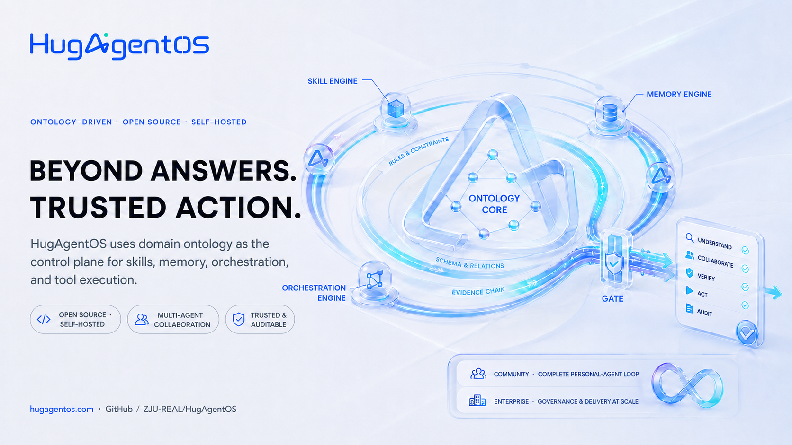
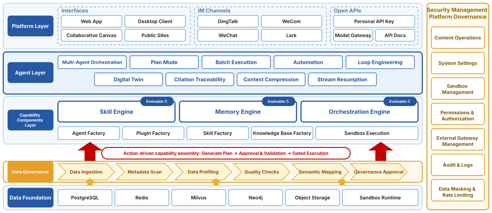

<p align="center">
  
</p>

<p align="center">
  <strong>HugAgentOS: the open-source Agent Harness that runs 24/7</strong>
</p>

<p align="center">
  Hand it your question, then close your laptop —<br />
  the agent keeps working in the cloud and tells you when it's done.
</p>

<p align="center">
  
</p>

<p align="center">
  <a href="./README.md">English</a> ·
  <a href="./README_CN.md">简体中文</a>
</p>

<!-- Keep these stable launch URLs so they can go live without another README redesign. -->
<p align="center">
  <a href="https://hugagentos.com">Website</a> ·
  <a href="https://app.hugagentos.com">Try HugAgentOS online</a>
</p>

<p align="center">
  <a href="./LICENSE">
    
  </a>
  <a href="./document/en/editions/overview.md">
    
  </a>
  <a href="./document/en/modules/chat.md">
    
  </a>
  <a href="./document/en/modules/personal-agent.md">
    
  </a>
  <a href="./document/en/architecture/overview.md">
    
  </a>
  <a href="./document/en/modules/mcp-tools.md">
    
  </a>
</p>

Models keep getting stronger, but getting an agent to **actually finish the job**
depends on the layer around the model: run lifecycle, context assembly, tools and
sandboxes, human approvals, memory, and failure recovery. That layer is the
**agent harness**.

HugAgentOS is an open-source, self-hosted agent harness built around the
**durable agent**: your request runs **in the cloud**, not in your browser or on your
computer. Close the tab, shut the laptop or go offline, and the task keeps moving;
you can also hand off tasks and get results in the IM app you use. On top of
that, HugAgentOS provides an always-on **Personal Agent** and runs in two forms —
**HugAgent Cloud** (on your server) and **HugAgent Local** (on your desktop) — which
can also be combined.

> [!NOTE]
> This Community repository is generated from the upstream main repository for
> each release and is marked `generated`. Report changes to `src/**` through an
> Issue or Discussion. Pull requests for documentation and examples are
> welcome. See [CONTRIBUTING.md](./CONTRIBUTING.md) for details.

## At a glance

| Situation | A typical chat assistant | HugAgentOS |
|---|---|---|
| You close your laptop | The task stops with it | The task keeps running in the cloud; come back to the result |
| The server restarts or fails | In-flight work is lost | Another instance takes over from the last saved progress |
| A step fails and retries | It may send the email twice | Operations with an uncertain outcome are never redone automatically |
| A very long task | Bound by timeouts and turn limits | No business time limit; it runs until the job is done |
| Reaching you | Waits for you to open the page | IM notifications, schedules and heartbeat reminders |
| Where it runs | Cloud or local, pick one | HugAgent Cloud, HugAgent Local, or a local + cloud hybrid |
| Over time | Starts from zero every time | Memory, procedures and skills accumulate, each approved and reversible |

## Demo

A 60-second tour: the same task run twice, with audited self-evolution in between —
memory, skills and orchestration each settled, and each taking effect only after you
approve it.

https://github.com/user-attachments/assets/635c5b35-10c0-47b9-a6f1-c73df9510e90

## ⏱️ Durable agent: close the laptop, the work goes on

Once you hand a task to HugAgentOS, it runs in cloud services and sandboxes — **your
device is just a window onto it**. Leave whenever you like, or come back on another
device; you always see the same progress and results.

```text
09:00  In Feishu, tell the agent: "Research pricing for competitors A, B and C, put it in a table and write a comparison report"
09:01  The agent replies "Started"; the task runs in a cloud sandbox → you close the laptop and go to a meeting
10:40  It needs to send an email: an approval reminder arrives in Feishu, and you approve it on the web from your phone
11:30  The report arrives in the same Feishu chat
11:35  Reply "Add D as well" → the same task picks it up, no restart
```

**Why it keeps going**

- **Runs in the cloud, not on your device**: background tasks, schedules and heartbeats
  run on the server, and working files live in a dedicated persistent sandbox. Closing
  the page doesn't stop anything, and any device can pick up the live progress.
- **Survives server failures**: progress is saved to the database step by step and
  executed by leased workers. If a process or machine dies, another instance takes over
  from the last saved progress instead of silently dropping the task.
- **Never repeats risky actions**: emails, writes to external systems and other
  operations record their intent and outcome. On recovery, anything that may or may not
  have happened is not redone automatically — you confirm "executed" or "not executed".
- **Runs until it's done**: long tasks and the
  [autonomous loop](./document/en/modules/autonomous-loop.md) have no total time limit or
  business turn cap; stall detection, failure circuit breakers and a hard backstop prevent
  runaways. Waiting for your approval or answer doesn't consume the execution budget.
- **Change your mind mid-run**: add requirements at any time and the agent takes them at
  its next step, with no cancel-and-restart.
- **Finds you when it needs you**: actions that need approval are approved on the web, with
  a reminder in IM; until you answer, the task waits instead of acting on its own.

> [!IMPORTANT]
> Continuous cloud operation relies on PostgreSQL, Redis and OpenSandbox — deploy
> **HugAgent Cloud** with Docker Compose. The one-command install uses SQLite and
> in-process state and is meant for trials and development.

## 🤖 Personal Agent: an agent that is always on

Personal Agent is built on the durable harness above: **one conversation, one
persistent identity, one permanent cloud computer**. You just say what you need; it
decides whether to answer right away or start a background task, and reports back
when the work is done.

| Capability | Description |
|---|---|
| 💬 **One entry, parallel background tasks** | Small talk and status questions are answered on the spot; research, reports, code and computer work become background tasks (3 in parallel by default, adjustable from 1 to 8). Follow-ups go in the same chat and it decides which task they belong to |
| 🖥️ **Permanent sandbox and cloud computer** | Each user gets a dedicated OpenSandbox with no expiry, with separate persistent volumes for the workspace and browser profile; a lost container is rebuilt on the same volumes |
| ⏰ **Schedules and heartbeats** | "Remind me to check email at 8 every morning" creates a schedule; heartbeats check `HEARTBEAT.md` at an interval and only speak up when something needs you |
| 📱 **Reachable on your channels** | Bind Feishu, DingTalk, WeChat or WeCom bots; each contact or group gets its own session and results go back where the request came from |
| ✅ **Execution you control** | Email, computer input and session writes need approval; every email is approved individually, other actions can be allowed for the rest of a task; a rejection makes it find another way |
| 🧠 **Persona and memory as files** | `SOUL.md`, `USER.md`, `MEMORY.md` and daily logs live in the workspace and can be viewed and edited in My Space; Dreaming periodically consolidates logs into long-term memory |
| 💻 **Connect your own computer** | In the desktop client's local + cloud mode, connect a Mac, Windows or Linux machine in one click and grant screen control or local session management; the device only polls outbound and opens no inbound ports |

Personal Agent is off by default in the Community Edition. In a HugAgent Cloud
deployment, set `PERSONAL_AGENT_ENABLED=true` and enable the `personal-agent` Compose
profile. See the [Personal Agent guide](./document/en/modules/personal-agent.md).

## ☁️ HugAgent Cloud and 💻 HugAgent Local

The same harness, placed wherever your data and compute should live.

| | **HugAgent Cloud** | **HugAgent Local** | **Local + cloud (hybrid)** |
|---|---|---|---|
| Runs on | Your server or private cloud | Your computer | Cloud as control plane, local machine as execution plane |
| Access | Browser, from any device | Desktop client (Windows / macOS / Linux) | Desktop client |
| Data and state | PostgreSQL, Redis, S3-compatible storage | Local SQLite, Milvus Lite, local files | Cloud projects stay in the cloud; local projects stay on the machine |
| Execution | Isolated OpenSandbox sandboxes with snapshots | Your real project directories, gated by folder grants and permission profiles | Both |
| Best for | 24/7 Personal Agent, long runs, IM channels | Offline work, sensitive data, local code and files | An always-on cloud agent that can also operate your machine and projects |
| Install with | Docker Compose | Desktop offline installer, or the one-command script | Choose "Local + cloud" in the desktop client |

- **HugAgent Cloud** is the complete durable harness, for work that must stay online,
  be reachable from any device and connect to IM channels. Each Docker sandbox uses a
  separate bridge with the trusted backend and controller; sandbox host ports are not
  published and peer sandboxes cannot reach each other's execd.
- **HugAgent Local** ships its own private Python runtime and services, so **no Python,
  Docker or database install is needed**. It can run fully offline with local models;
  once a local project is bound, Bash and file tools work directly in the project's real
  directory. A failed upgrade rolls back to the previous version and data backup.
- **Hybrid mode** uses one cloud account: cloud conversations are stored in the cloud,
  while only local projects' conversations, files and execution stay on the machine.
  This is also how Personal Agent "connects this computer" so an always-on cloud agent
  can operate your desktop.

See [Desktop local mode](./document/en/deployment/desktop-local-mode.md) and
[Local project workspace](./document/en/deployment/local-project-workspace.md).

## 🧬 Self-evolution: better with real work, audited at every step

HugAgentOS does not make the agent start from zero every time — and does not let it
quietly learn the wrong things.

- **Learning procedures from trajectories**: the post-response memory pipeline keeps
  outcome-verified trajectories such as "failure → user correction → success" as
  reusable **procedural** memory instead of facts that go stale; stable procedures can
  be compiled further into skills.
- **Three memory layers**: L1 personal profile, L2 vector procedural memory (Milvus,
  optional) and L3 relationship graph (Neo4j, optional). Writes go through a durable
  outbox so crash replays never add duplicates, and a sanitizer filters credentials.
- **Approved one by one, reversible**: evolution proposals for memory and skills appear
  as cards and only take effect after you confirm them; you can switch it off at any time.
- **Dreaming for Personal Agent**: a daily job consolidates logs into `MEMORY.md` /
  `USER.md`, with `DREAMS.md` recording sources, deduplication and conflicts; only what
  you explicitly asked it to remember is promoted automatically.
- **Traceable ontology evolution**: approvals, rejections, evidence and outcomes are
  recorded and organized into versioned ontology proposals that apply after human review.

## 🧰 More harness capabilities

| Capability | Description |
|---|---|
| 🔁 **Autonomous loop** | Goals survive across turns until done; maker ≠ checker — a worker does the work, a read-only reviewer verifies the real output, and command-checkable requirements are verified by the driver itself |
| 🗺️ **Plan Mode** | Plan first, then execute step by step with per-step MCP, skill and sub-agent bindings; resumable like any run |
| 🤝 **Sub-agents** | Built-in explorer, worker and reviewer, plus your own sub-agents, routed automatically or by `@` mention |
| 🔧 **MCP, Skills and plugins** | Built-in web search, page fetching, knowledge retrieval, charts and automation tools; an MCP marketplace, private MCP servers, Agent Skills and plugins |
| 🧪 **Sandbox and artifacts** | Run code in OpenSandbox or a local subprocess sandbox, producing charts, reports, Office files, web pages and data canvases |
| 📚 **Private knowledge-base RAG** | Document chunking, hybrid vector and keyword retrieval, optional reranking |
| 🛡️ **Optional ontology control plane** | With a Domain Pack, deterministic rule checks run before tool execution and high-risk answers are reviewed by an independent reviewer or committee; switched off, the original flow is unchanged |
| 🔌 **Replaceable models** | Connect cloud or local OpenAI-compatible models through one model service; reviewer, planner, memory and other roles can each use their own model |

## Quick start

Every option needs an OpenAI-compatible or local model. **The initial account and
password are both `admin` and must be changed on first sign-in; the Community Edition
has no self-registration.**

### HugAgent Cloud: Docker Compose (recommended for 24/7)

Install Git, Docker, and Compose v2 first.

```bash
git clone https://github.com/ZJU-REAL/HugAgentOS.git
cd HugAgentOS
cp .env.example .env
mkdir -p data/storage
docker compose build backend
docker compose up -d --build
```

Open [http://localhost:3002](http://localhost:3002), sign in, and connect a model
under **Settings → System administration → Model services**. See the
[Docker Compose guide](./document/en/deployment/docker-compose.md) for persistence
and production settings, and [Deploy Personal Agent](./document/en/modules/personal-agent.md#deploy)
to enable it.

### HugAgent Local: desktop client

Download the installer for your platform from
[Releases](https://github.com/ZJU-REAL/HugAgentOS/releases) and choose "Local only",
"Cloud only" or "Local + cloud" on first launch. The full offline package bundles its
runtime, so nothing else needs to be installed.

### Developer trial: one-command install (Linux / macOS / WSL2)

Requires Python 3.11+, Node.js 20+, Git and `curl`. No Docker, PostgreSQL or
Redis needed.

```bash
curl -fsSL https://raw.githubusercontent.com/ZJU-REAL/HugAgentOS/main/install.sh | bash
```

The installer clones the source into `~/.hugagent/source`, creates an isolated
Python environment, builds the web app and runs the first-time setup wizard, then
opens [http://127.0.0.1:3001](http://127.0.0.1:3001). Start it again later with
`~/.hugagent/venv/bin/hugagent-server`.

> [!WARNING]
> It listens on `127.0.0.1` only by default. If you really need remote access, use
> `hugagent-server serve --host 0.0.0.0 --port 3001 --no-browser`, and set up a strong
> password, a firewall and HTTPS first. Don't expose it directly on an untrusted network.

The one-command install uses SQLite, in-process state and a local subprocess
sandbox, which suits trials and development. See the
[quick install guide](./document/en/deployment/quick-install.md) for options and
troubleshooting.

## Architecture

HugAgentOS separates user channels, agent workflows, reusable capability engines,
ontology contracts, data governance, and infrastructure into clear layers. Durable
runs, leases and recovery run through the execution path, while security and
platform governance span the complete stack.



> [!NOTE]
> The diagram shows the complete HugAgentOS product architecture. Some
> governance, collaboration, and gateway capabilities are
> available only in Enterprise Edition.

### Technology stack

| Layer | Main technologies |
|---|---|
| Agent runtime | AgentScope 2.0, ReAct, Model Context Protocol |
| Backend | Python, FastAPI, SQLAlchemy, Alembic |
| Frontend | React 19, TypeScript, Vite, Zustand, Ant Design |
| Desktop | Tauri 2, private CPython 3.11 runtime |
| Data and state | SQLite or PostgreSQL 15, in-process state or Redis 7, local or S3-compatible storage |
| Sandbox | OpenSandbox, local subprocess |
| Optional memory | Milvus 2.4, Neo4j 5 Community, mem0 |
| Deployment | Desktop installer, one-command installer, Docker Compose, Nginx |

See the [architecture overview](./document/en/architecture/overview.md) for the
full request lifecycle, container topology, and design decisions.

## Community and Enterprise editions

Community Edition lets an individual run the complete harness and Personal Agent.
Enterprise Edition adds the governance, collaboration, and delivery capabilities
needed to operate the same experience across an organization. Enterprise-only
source is physically absent from the Community tree.

| Community Edition | Enterprise Edition adds |
|---|---|
| Durable runs, autonomous loop, Plan Mode, and personal sub-agents | Teams, organization agents, and permission matrices |
| Personal Agent: background tasks, dedicated computer, channels, schedules, and file memory | User, role, and team authorization, plus cross-device session management |
| General MCP tools, personal skills, and a skill marketplace | Industry data tools, organization governance, and skill review |
| Private knowledge bases, three-tier personal memory, and personal evolution | Public knowledge administration and memory auditing |
| Automation, and a personal data canvas | Organization billing, usage reports, and canvas collaboration |
| OpenSandbox sessions, snapshots, and S3 file storage; desktop local mode | Team workspace mounts, Cube, additional cloud providers, and offline delivery |
| Local accounts and branding with Powered-by attribution | SSO, compliance auditing, and full white-labeling |

See the [edition overview](./document/en/editions/overview.md) for the complete
feature boundary and upgrade path.

## Documentation

| Goal | English | 中文文档 |
|---|---|---|
| Understand the product | [Introduction](./document/en/getting-started/introduction.md) | [产品简介](./document/zh-CN/getting-started/introduction.md) |
| Run it in 10 minutes | [Quick start](./document/en/getting-started/quick-start.md) | [快速开始](./document/zh-CN/getting-started/quick-start.md) |
| Run lifecycle and resumable streams | [Chat](./document/en/modules/chat.md) | [智能对话](./document/zh-CN/modules/chat.md) |
| The always-on personal agent | [Personal Agent](./document/en/modules/personal-agent.md) | [Personal Agent](./document/zh-CN/modules/personal-agent.md) |
| Long-running self-driven tasks | [Autonomous loop](./document/en/modules/autonomous-loop.md) | [自主循环](./document/zh-CN/modules/autonomous-loop.md) |
| Desktop local and hybrid modes | [Desktop local mode](./document/en/deployment/desktop-local-mode.md) | [桌面离线本机模式](./document/zh-CN/deployment/desktop-local-mode.md) |
| Memory and self-evolution | [Memory](./document/en/modules/memory.md) | [记忆系统](./document/zh-CN/modules/memory.md) |
| Configure a deployment | [Deployment](./document/en/deployment/README.md) | [部署指南](./document/zh-CN/deployment/README.md) |
| Explore the system design | [Architecture](./document/en/architecture/overview.md) | [架构总览](./document/zh-CN/architecture/overview.md) |
| The ontology control plane | [Domain ontology quickstart](./document/en/getting-started/domain-ontology-quickstart.md) | [快速构建领域本体](./document/zh-CN/getting-started/domain-ontology-quickstart.md) |
| Build backend or frontend features | [Development](./document/en/README.md#development) | [开发指南](./document/zh-CN/README.md#开发指南) |

Start from [document/README.md](./document/README.md) to browse every guide.

## Roadmap

1. **Seamless Cloud/Local switching across clients** — building on today's hybrid
   mode, one server deployment serving multiple clients, keeping conversations,
   agents, skills, files and task state in sync.
2. **Adaptive model routing based on Mixture of Agents** — select or combine models
   by task complexity, modality, latency and cost: light models for simple work,
   stronger ones only when the task warrants it.
3. **A richer extension ecosystem** — more built-in and community agents, skills,
   MCP servers and plugins, with better discovery, installation, updates, and
   quality and security review.

## Contributing

We welcome bug reports, feature proposals, documentation improvements, and
reproducible patches. Read [CONTRIBUTING.md](./CONTRIBUTING.md) before you
start so you understand the boundary between generated and directly editable
content. By participating, you agree to follow our bilingual
[Community Code of Conduct](./CODE_OF_CONDUCT.md).

- Include reproduction steps, expected behavior, actual behavior, and your
  environment in bug reports.
- Explain the concrete use case and problem when proposing a feature.
- Keep English and Chinese documentation aligned with the Community and
  Enterprise edition boundary.

Don't open a public Issue for a security vulnerability. Follow
[SECURITY.md](./SECURITY.md) to report it through a private channel.

## License

HugAgentOS Community Edition is licensed under Apache License 2.0 with
supplementary terms. The terms restrict operating the software as a competing
multi-tenant SaaS offering and require the UI's Powered-by attribution to
remain visible. [LICENSE](./LICENSE) and [NOTICE](./NOTICE) define the complete
rights and obligations for internal use, modification, and distribution.
