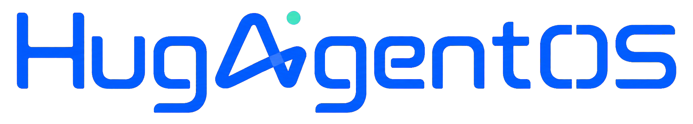
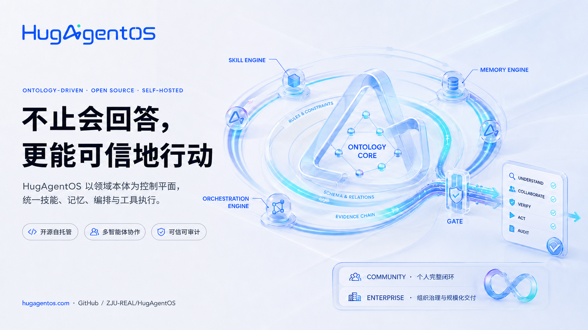
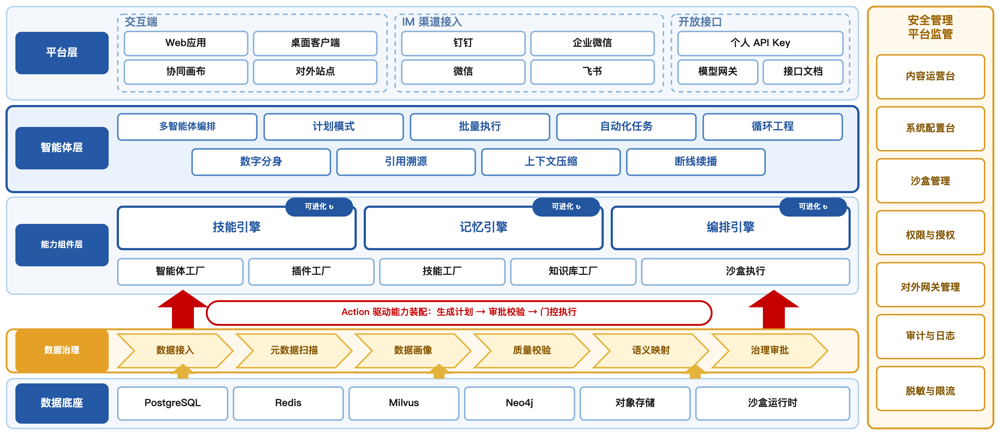

<p align="center">
  
</p>

<p align="center">
  <strong>HugAgentOS：7×24 小时持久运行的开源 Agent Harness</strong>
</p>

<p align="center">
  把问题交给它，然后合上电脑——<br />
  智能体在云端继续干活，做完再告诉你。
</p>

<p align="center">
  
</p>

<p align="center">
  <a href="./README.md">English</a> ·
  <a href="./README_CN.md">简体中文</a>
</p>

<!-- 预留稳定的上线地址，官网与在线体验启用后无需重新调整 README 结构。 -->
<p align="center">
  <a href="https://hugagentos.com">官方网站</a> ·
  <a href="https://app.hugagentos.com">在线使用</a>
</p>

<p align="center">
  <a href="./LICENSE">
    
  </a>
  <a href="./document/zh-CN/editions/overview.md">
    
  </a>
  <a href="./document/zh-CN/modules/chat.md">
    
  </a>
  <a href="./document/zh-CN/modules/personal-agent.md">
    
  </a>
  <a href="./document/zh-CN/architecture/overview.md">
    
  </a>
  <a href="./document/zh-CN/modules/mcp-tools.md">
    
  </a>
</p>

模型能力越来越强，但让智能体**真正把一件事干完**，靠的是模型之外的那一层：
运行生命周期、上下文装配、工具与沙箱、人工审批、记忆、故障恢复。这一层就是
**Agent Harness**。

HugAgentOS 是一个开源、可自托管的 Agent Harness，核心是 **Durable Agent**：
你提出的问题在**云端**执行，而不是依赖你的浏览器或电脑。关掉网页、合上笔记本、
断网下班，任务都会继续推进；你也可以在常用的 IM 里下达任务、接收结果。在此之上，
我们提供一个 7×24 小时在线的 **Personal Agent**，并以 **HugAgent Cloud**（服务器）
和 **HugAgent Local**（桌面本机）两种形态运行，二者还可以混合使用。

> [!NOTE]
> 本社区仓库由上游主仓按发布版本自动生成，并标记为 `generated`。
> `src/**` 的修改请通过 Issue 或 Discussion 反馈；文档与示例欢迎直接提交 PR。
> 详细规则见 [CONTRIBUTING.md](./CONTRIBUTING.md)。

## 一眼看懂

| 场景 | 普通对话式 AI | HugAgentOS |
|---|---|---|
| 你合上电脑 | 任务跟着停下 | 任务在云端继续，回来直接看结果 |
| 服务器重启或宕机 | 进行中的任务丢失 | 其他实例接管，从上次保存的进度继续 |
| 中途失败重试 | 可能重复发邮件、重复写入 | 不确定是否成功的操作不会自动重做 |
| 很长的任务 | 受超时和轮数上限约束 | 不设业务时限，跑到做完为止 |
| 怎么找到你 | 只能等你打开网页 | IM 推送、定时任务、心跳主动提醒 |
| 在哪运行 | 云端或本地二选一 | HugAgent Cloud / HugAgent Local / 本机 + 云端混合 |
| 用得越久 | 每次从零开始 | 记忆、做法与技能持续沉淀，逐条审批、可回滚 |

## 演示

60 秒速览：同一个任务做两次——中间是受审计的自进化，记忆、技能与编排逐条沉淀，
每一步都要经你确认才生效。

https://github.com/user-attachments/assets/a268e371-a11f-488b-98d4-08598e2fdf89

## ⏱️ Durable Agent：合上电脑，任务继续

把问题交给 HugAgentOS 后，任务运行在云端的服务和沙箱里，**你的设备只是一个入口**。
你可以随时离开，也可以换一台设备回来，看到的始终是同一份进度和结果。

```text
09:00  在飞书里对智能体说：「调研竞品 A、B、C 的定价，整理成表格并写一份对比报告」
09:01  智能体回复「已开始」，任务在云端沙箱里运行 → 你合上电脑去开会
10:40  要发一封邮件？飞书里收到审批提醒，你在手机上打开网页点「批准」
11:30  同一个飞书对话里收到汇报：报告完成
11:35  接着回一句「再加上 D」→ 同一个任务继续做，不用从头来
```

**为什么能一直跑下去**

- **执行在云端，不依赖你的设备**：后台任务、定时任务和心跳都在服务端运行，任务的工作文件
  保存在专属的持久沙箱中。关掉页面不会停止任务，任意设备打开都能接着看实时进度。
- **服务器出问题也不丢**：任务进度按步写入数据库，并由带租约的 worker 执行。进程或机器中断后，
  其他实例接管，从最后保存的进度继续，而不是悄悄消失。
- **不会重复做有风险的事**：发邮件、写入外部系统等操作都会记录意图与结果；恢复时，不确定是否
  已经执行的操作不会自动重做，而是请你确认「已执行 / 未执行」。
- **跑到做完为止**：长任务和[自主循环](./document/zh-CN/modules/autonomous-loop.md)不设总时长和
  业务轮次上限；停滞检测、异常熔断和硬性后备防止失控。等你审批或回答期间，不消耗执行预算。
- **中途可以改主意**：运行中随时补充要求，智能体在下一步采纳，不用取消重来。
- **需要你时会找你**：需要审批的操作会在 IM 中提醒、在网页上批准；你没回复之前，任务等待而不是擅自行动。

> [!IMPORTANT]
> 云端持续运行依赖 PostgreSQL、Redis 与 OpenSandbox，请使用 **HugAgent Cloud**
> （Docker Compose）部署。一键安装使用 SQLite 与进程内状态，适合个人试用与开发。

## 🤖 Personal Agent：一个一直在线的个人智能体

Personal Agent 构建在上述 Durable Harness 之上：**一个对话入口、一个持续存在的身份、
一台永久的云端电脑**。你只管说事，它决定是当场回答，还是开一个后台任务去做，
做完再回来汇报。

| 能力 | 说明 |
|---|---|
| 💬 **单一入口，并行后台任务** | 闲聊、查进度当场回答；调研、写报告、跑代码、操作电脑自动转为后台任务（默认并行 3 个，可调 1–8）。补充要求直接说，它自己判断归属哪个任务 |
| 🖥️ **永久沙盒与云电脑** | 每个用户一台不设到期时间的专属 OpenSandbox，工作目录与浏览器资料独立持久卷；容器丢失时复用卷重建 |
| ⏰ **定时任务与心跳** | 「每天 8 点提醒我看邮件」创建定时任务；心跳按间隔对照 `HEARTBEAT.md` 自查，无事不打扰，有事才提醒 |
| 📱 **多渠道在线** | 绑定飞书、钉钉、微信、企业微信机器人；每个联系人或群拥有独立会话，结果发回来源会话 |
| ✅ **可控的执行权** | 邮件、电脑输入、会话写入需要批准；邮件逐封批准，其他可「本任务内同类操作都允许」；拒绝后改用其他方法 |
| 🧠 **文件化的人格与记忆** | 工作区里的 `SOUL.md`、`USER.md`、`MEMORY.md` 与每日日志，可在「我的空间」直接查看与编辑；Dreaming 定期把日志整理为长期记忆 |
| 💻 **连接你的电脑** | 在桌面客户端「本机 + 云端」模式下一键连接 Mac / Windows / Linux，按授权接管屏幕或管理本机会话；设备只出站轮询，不开放入站端口 |

Personal Agent 在社区版中默认关闭，在 HugAgent Cloud 部署中设置
`PERSONAL_AGENT_ENABLED=true` 并启用 `personal-agent` Compose profile 后即可使用。
完整说明见 [Personal Agent 文档](./document/zh-CN/modules/personal-agent.md)。

## ☁️ HugAgent Cloud 与 💻 HugAgent Local

同一套 Harness，按你的数据和算力放在哪里来选择运行形态。

| | **HugAgent Cloud** | **HugAgent Local** | **本机 + 云端（混合）** |
|---|---|---|---|
| 运行位置 | 你的服务器 / 私有云 | 你的电脑 | 云端为控制面，本机为执行面 |
| 入口 | 浏览器，多端访问 | 桌面客户端（Windows / macOS / Linux） | 桌面客户端 |
| 数据与状态 | PostgreSQL、Redis、S3 兼容存储 | 本地 SQLite、Milvus Lite、本地文件 | 云端项目存云端，本地项目留本机 |
| 执行环境 | OpenSandbox 隔离沙箱，快照恢复 | 本机真实项目目录，按目录授权与权限档执行 | 两者兼有 |
| 适合 | 7×24 Personal Agent、长跑任务、多渠道接入 | 离线、敏感数据、本地代码与文件 | 云端常驻 + 操作本机电脑与项目 |
| 部署方式 | Docker Compose | 桌面离线安装包；或一键安装脚本 | 桌面客户端选择「本机 + 云端」 |

- **HugAgent Cloud**：完整的 Durable Harness。适合需要一直在线、跨设备访问、接入 IM 渠道的场景。
  每个 Docker 沙箱与受信任的后端和控制器使用独立网桥，不发布沙箱宿主端口，沙箱之间不能互访 execd。
- **HugAgent Local**：桌面安装包自带私有 Python 运行时与服务，**不需要安装 Python、Docker
  或数据库**，可完全离线运行并接入本地模型；绑定本地项目后，Bash 与文件工具直接在项目真实
  目录中工作。升级失败自动回滚到上一版本与数据备份。
- **混合模式**：一套云端账号，云端会话存云端；只有本地项目的对话、文件与执行留在本机。
  Personal Agent 可以借此「连接这台电脑」，让云端常驻的智能体操作你的本机。

详见[桌面离线本机模式](./document/zh-CN/deployment/desktop-local-mode.md)与
[本机项目工作目录](./document/zh-CN/deployment/local-project-workspace.md)。

## 🧬 自进化：从真实工作中变强，每一步都可审计

HugAgentOS 不让智能体每次从零开始，也不让它「悄悄学坏」。

- **从轨迹中学做法**：后置记忆流水线会识别「失败 → 用户纠正 → 再次成功」这类经过结果验证
  的轨迹，沉淀为可复用的**做法（procedural）**，而不是记住会过期的事实；稳定做法可以进一步
  编译为技能。
- **三层记忆**：L1 个人画像、L2 向量做法记忆（Milvus，可选）、L3 关系图谱（Neo4j，可选）；
  写入走持久 Outbox，崩溃重放不会重复新增，脱敏闸门过滤凭据。
- **逐条审批、可回滚**：记忆与技能的进化建议以卡片形式出现，经你确认才生效，可随时关闭。
- **Personal Agent 的 Dreaming**：每天定时把日志整理为 `MEMORY.md` / `USER.md` 的更新，
  `DREAMS.md` 记录来源、去重与冲突；只自动提升你明确说「记住」的内容。
- **可溯的本体进化**：审批、驳回、证据与执行结果留痕，整理为版本化的本体建议，人工审核后生效。

## 🧰 更多 Harness 能力

| 能力 | 说明 |
|---|---|
| 🔁 **自主循环** | 目标跨轮存活、做完为止；maker≠checker：worker 干活、只读评审员亲验产出，命令可判定的需求由 driver 机检 |
| 🗺️ **计划模式** | 先出计划再逐步执行，步骤级绑定 MCP / 技能 / 子智能体，同样支持断线续播 |
| 🤝 **子智能体** | 内置 explorer / worker / reviewer，可创建个人子智能体，自动路由或 `@` 提及协同 |
| 🔧 **MCP · Skills · 插件** | 内置联网搜索、网页抓取、知识检索、图表、自动化等工具；MCP 市场、私有 MCP、Agent Skills 与插件 |
| 🧪 **沙箱与产物** | OpenSandbox 或子进程沙箱执行代码，产出图表、报告、Office 文件、网页与数据画布 |
| 📚 **私有知识库 RAG** | 文档分块，向量与关键词混合检索，可选重排 |
| 🛡️ **可选的本体控制平面** | 导入 Domain Pack 后，工具执行前做确定性规则检查，高风险答案由独立评审员或委员会复核；关闭时完全不改变原流程 |
| 🔌 **模型可替换** | 统一的模型服务配置接入云端或本地 OpenAI 兼容模型，评审、规划、记忆等角色可分别指定模型 |

## 快速开始

所有方式都需要准备 OpenAI 兼容模型或本地模型。**初始账号与密码均为 `admin`，首次登录必须修改；
CE 不提供自助注册。**

### HugAgent Cloud：Docker Compose（推荐用于 7×24）

需先安装 Git、Docker 与 Compose v2。

```bash
git clone https://github.com/ZJU-REAL/HugAgentOS.git
cd HugAgentOS
cp .env.example .env
mkdir -p data/storage
docker compose build backend
docker compose up -d --build
```

打开 [http://localhost:3002](http://localhost:3002)，登录后进入「设置 → 系统管理 →
模型服务」接入模型。启用 Personal Agent、持久化与生产配置见
[Docker Compose 部署指南](./document/zh-CN/deployment/docker-compose.md)和
[Personal Agent 部署](./document/zh-CN/modules/personal-agent.md#部署)。

### HugAgent Local：桌面客户端

从 [Releases](https://github.com/ZJU-REAL/HugAgentOS/releases) 下载对应平台的桌面安装包，
首次启动选择「仅本机」「仅云端」或「本机 + 云端」。完整离线包自带运行时，无需额外安装依赖。

### 开发者试用：一键安装（Linux / macOS / WSL2）

需要 Python 3.11+、Node.js 20+、Git 和 `curl`；不需要 Docker、PostgreSQL 或 Redis。

```bash
curl -fsSL https://raw.githubusercontent.com/ZJU-REAL/HugAgentOS/main/install.sh | bash
```

安装器会把源码拉到 `~/.hugagent/source`，创建隔离 Python 环境、构建 Web 应用并进入
首次配置向导，完成后打开 [http://127.0.0.1:3001](http://127.0.0.1:3001)。之后用
`~/.hugagent/venv/bin/hugagent-server` 再次启动。

> [!WARNING]
> 默认仅监听 `127.0.0.1`。确需远程访问时用
> `hugagent-server serve --host 0.0.0.0 --port 3001 --no-browser`，并先配置强密码、防火墙
> 与 HTTPS，不要直接暴露在不受信任的网络中。

一键安装使用 SQLite、进程内状态与本地子进程沙箱，适合试用与开发；选项与故障
排查见[一键安装指南](./document/zh-CN/deployment/quick-install.md)。

## 系统架构

HugAgentOS 将用户渠道、智能体工作流、可复用能力引擎、本体契约、数据治理和
基础设施分层组织；Durable Run、租约与恢复机制贯穿执行链路，安全管理与平台监管
贯穿完整技术栈。



> [!NOTE]
> 架构图展示 HugAgentOS 的完整产品架构。其中部分治理、协作和网关能力仅在商业版中提供。

### 技术栈

| 层级 | 主要技术 |
|---|---|
| 智能体运行时 | AgentScope 2.0、ReAct、Model Context Protocol |
| 后端 | Python、FastAPI、SQLAlchemy、Alembic |
| 前端 | React 19、TypeScript、Vite、Zustand、Ant Design |
| 桌面端 | Tauri 2、私有 CPython 3.11 运行时 |
| 数据与状态 | SQLite 或 PostgreSQL 15、进程内状态或 Redis 7、本地或 S3 兼容存储 |
| 沙箱 | OpenSandbox、本地子进程 |
| 可选记忆 | Milvus 2.4、Neo4j 5 Community、mem0 |
| 部署 | 桌面安装包、一键安装、Docker Compose、Nginx |

更详细的请求生命周期、容器拓扑和关键设计决策见
[架构总览](./document/zh-CN/architecture/overview.md)。

## 社区版与商业版

社区版让个人把完整的 Harness 与 Personal Agent 运行起来；商业版在相同产品体验上补充
组织级治理、协作和交付能力。商业版能力不会以关闭开关的形式混入社区版源码。

| 社区版（CE） | 商业版（EE）新增 |
|---|---|
| Durable Run、自主循环、计划模式与个人子智能体 | 团队、成员、组织级智能体库与权限矩阵 |
| Personal Agent：后台任务、专属电脑、渠道、调度与文件记忆 | 用户、角色、团队授权治理与跨设备会话管理 |
| 通用 MCP、个人技能与技能市场 | 行业数据工具、组织级能力治理与技能审核 |
| 私有知识库、三层个人记忆与个人进化 | 公共知识库管理与记忆审计 |
| 自动化、个人数据画布 | 组织计费、用量汇总与画布多人协同 |
| OpenSandbox、快照与 S3 文件存储；桌面本机模式 | 团队挂载、其他云存储与离线商业交付 |
| 本地账号与保留 Powered-by 的品牌配置 | SSO、审计合规与完整 white-label |

功能边界与升级路径以
[社区版与商业版说明](./document/zh-CN/editions/overview.md)为准。

## 文档

| 你想了解 | 中文文档 | English |
|---|---|---|
| 项目定位与整体能力 | [产品简介](./document/zh-CN/getting-started/introduction.md) | [Introduction](./document/en/getting-started/introduction.md) |
| 10 分钟运行项目 | [快速开始](./document/zh-CN/getting-started/quick-start.md) | [Quick start](./document/en/getting-started/quick-start.md) |
| Run 生命周期与断线续播 | [智能对话](./document/zh-CN/modules/chat.md) | [Chat](./document/en/modules/chat.md) |
| 7×24 个人智能体 | [Personal Agent](./document/zh-CN/modules/personal-agent.md) | [Personal Agent](./document/en/modules/personal-agent.md) |
| 长时运行的自驱动任务 | [自主循环](./document/zh-CN/modules/autonomous-loop.md) | [Autonomous loop](./document/en/modules/autonomous-loop.md) |
| 桌面本机与混合模式 | [桌面离线本机模式](./document/zh-CN/deployment/desktop-local-mode.md) | [Desktop local mode](./document/en/deployment/desktop-local-mode.md) |
| 记忆与自进化 | [记忆系统](./document/zh-CN/modules/memory.md) | [Memory](./document/en/modules/memory.md) |
| 生产部署与环境变量 | [部署指南](./document/zh-CN/deployment/README.md) | [Deployment](./document/en/deployment/README.md) |
| 系统设计与请求链路 | [架构总览](./document/zh-CN/architecture/overview.md) | [Architecture](./document/en/architecture/overview.md) |
| 领域本体控制平面 | [领域本体快速入门](./document/zh-CN/getting-started/domain-ontology-quickstart.md) | [Domain ontology quickstart](./document/en/getting-started/domain-ontology-quickstart.md) |
| 后端与前端开发 | [开发指南](./document/zh-CN/README.md#开发指南) | [Development](./document/en/README.md#development) |

所有文档入口见 [document/README.md](./document/README.md)。

## 路线图

1. **Cloud / Local 无缝切换与多端互通** —— 在现有混合模式基础上，一套服务端连接多客户端，
   同步会话、智能体、技能、文件与任务状态。
2. **基于 MoA 的自适应模型路由** —— 按任务复杂度、模态、时延与成本选择或组合模型，
   简单任务用轻量模型，复杂任务再升级。
3. **更丰富的扩展生态** —— 持续扩充智能体、技能、MCP 服务与插件，完善发现、安装、
   更新与质量/安全审核流程。

## 参与贡献

我们欢迎问题反馈、功能建议、文档改进和可复现的补丁。提交前请先阅读
[贡献指南](./CONTRIBUTING.md)，了解生成代码与可直接修改内容的边界。参与社区
即表示同意遵守中英双语的[社区行为准则](./CODE_OF_CONDUCT.md)。

- 报告 Bug 时，请附复现步骤、期望行为、实际行为和运行环境。
- 提议功能时，请说明具体使用场景，以及它解决了什么问题。
- 修改文档或示例时，请保持中英文内容与 CE/EE 边界一致。

发现安全漏洞时不要创建公开 Issue。请按照
[安全策略](./SECURITY.md)提供的私密渠道报告。

## 许可证

HugAgentOS Community Edition 采用 Apache License 2.0 并附加补充条款。
补充条款限制将本软件作为竞争性的多租户 SaaS 转售，并要求保留界面中的
Powered-by 标识。内部使用、修改和分发的完整权利与义务以
[LICENSE](./LICENSE)和 [NOTICE](./NOTICE)为准。
